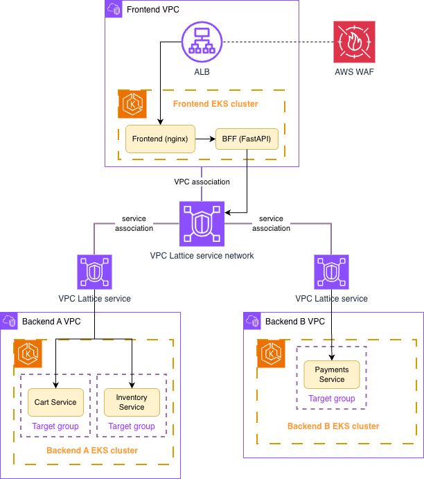

# Streamline Amazon EKS Application Networking with Gateway API

This repository contains a complete walkthrough for using Kubernetes Gateway API with both AWS Load Balancer Controller (LBC) and Amazon VPC Lattice to build a multi-cluster application networking architecture on Amazon EKS.

## What You'll Build

A three-cluster architecture demonstrating:
- **North-South Traffic**: External clients → ALB (via AWS LBC Gateway API) → Edge cluster
- **East-West Traffic**: Edge cluster → Internal services (via VPC Lattice Gateway API) → Apps clusters
- **End-to-End Integration**: Shop service aggregating data from payments and inventory services across clusters

```
Internet → ALB (shop.api.example.com) → Edge EKS Cluster
                                           ↓ (VPC Lattice)
                                    ┌──────┴──────┐
                                    ↓             ↓
                            Apps-A EKS      Apps-B EKS
                            (payments)      (inventory)
```

## Architecture



**Three EKS Clusters:**
- **edge-eks**: Hosts the shop.api.example.com service, exposed via ALB
- **apps-a-eks**: Hosts the payments.api.example.com service
- **apps-b-eks**: Hosts the inventory.api.example.com service

**Two Gateway API Controllers:**
- **AWS Load Balancer Controller**: Provisions ALB for internet-facing ingress
- **VPC Lattice Gateway API Controller**: Creates service network for cross-cluster communication

## Prerequisites

Before you begin, you'll need:

### Tools
- [AWS CLI](https://docs.aws.amazon.com/cli/latest/userguide/getting-started-install.html) v2.x or later
- [kubectl](https://kubernetes.io/docs/tasks/tools/) v1.28 or later
- [helm](https://helm.sh/docs/intro/install/) v3.x or later
- [eksctl](https://eksctl.io/installation/) v0.150.0 or later
- [jq](https://jqlang.github.io/jq/download/) for JSON parsing

### AWS Resources
- AWS account with appropriate permissions
- Three VPCs (or use default VPCs for testing)
- ACM certificate for your domain (we use a private certificate in this example)

### Knowledge
- Basic Kubernetes concepts (Pods, Services, Deployments)
- Familiarity with kubectl commands
- Understanding of AWS networking (VPCs, security groups)

**New to Kubernetes?** Don't worry! This walkthrough includes detailed explanations and troubleshooting tips for common issues.

## Repository Structure

```
.
├── README.md                          # This file
├── manifests/
│   ├── edge-cluster/                  # Edge cluster resources
│   │   ├── 01-shop-deployment.yaml
│   │   ├── 02-shop-service.yaml
│   │   ├── 03-alb-gatewayclass.yaml
│   │   ├── 04-alb-gateway.yaml
│   │   └── 05-alb-httproute.yaml
│   ├── apps-a-cluster/                # Apps-A cluster resources
│   │   ├── 01-payments-deployment.yaml
│   │   ├── 02-payments-service.yaml
│   │   ├── 03-lattice-gatewayclass.yaml
│   │   ├── 04-lattice-gateway.yaml
│   │   └── 05-lattice-httproute.yaml
│   ├── apps-b-cluster/                # Apps-B cluster resources
│   │   ├── 01-inventory-deployment.yaml
│   │   ├── 02-inventory-service.yaml
│   │   ├── 03-lattice-gatewayclass.yaml
│   │   ├── 04-lattice-gateway.yaml
│   │   └── 05-lattice-httproute.yaml
│   └── shared/
│       └── vpc-association-policy.yaml
├── scripts/
│   ├── setup-edge-cluster.sh         # Helper script for edge cluster
│   ├── setup-apps-cluster.sh         # Helper script for apps clusters
│   └── cleanup.sh                     # Cleanup all resources
├── docs/
│   ├── architecture.png
│   └── screenshots/
└── TROUBLESHOOTING.md                 # Common issues and solutions
```

## Quick Start

### Step 1: Set Up Edge Cluster (ALB for Ingress)

```bash
# Configure kubectl for edge cluster
aws eks update-kubeconfig --region us-west-2 --name edge-eks

# Run setup script
./scripts/setup-edge-cluster.sh

# Deploy shop service
kubectl apply -f manifests/edge-cluster/
```

### Step 2: Set Up Apps-A Cluster (VPC Lattice)

```bash
# Configure kubectl for apps-a cluster
aws eks update-kubeconfig --region us-west-2 --name apps-a-eks

# Run setup script
./scripts/setup-apps-cluster.sh apps-a

# Deploy payments service
kubectl apply -f manifests/apps-a-cluster/
```

### Step 3: Set Up Apps-B Cluster (VPC Lattice)

```bash
# Configure kubectl for apps-b cluster
aws eks update-kubeconfig --region us-west-2 --name apps-b-eks

# Run setup script
./scripts/setup-apps-cluster.sh apps-b

# Deploy inventory service
kubectl apply -f manifests/apps-b-cluster/
```

### Step 4: Test the Integration

See [Testing Guide](./docs/TESTING.md) for detailed testing steps.

## Detailed Walkthrough

For a complete step-by-step guide with explanations, see:
- [Part 1: Edge Cluster Setup (AWS LBC)](./docs/PART1-EDGE-CLUSTER.md)
- [Part 2: Apps Clusters Setup (VPC Lattice)](./docs/PART2-APPS-CLUSTERS.md)
- [Part 3: End-to-End Integration](./docs/PART3-INTEGRATION.md)

## Troubleshooting

Having issues? Check [TROUBLESHOOTING.md](./TROUBLESHOOTING.md) for:
- Pod CrashLoopBackOff debugging
- Gateway/Route status issues
- Security group configuration
- Certificate problems
- Common kubectl commands

## Cleanup

To remove all resources:

```bash
./scripts/cleanup.sh
```

## Related Resources

- [AWS Load Balancer Controller Documentation](https://kubernetes-sigs.github.io/aws-load-balancer-controller/)
- [VPC Lattice Gateway API Controller Documentation](https://www.gateway-api-controller.eks.aws.dev/)
- [Kubernetes Gateway API Specification](https://gateway-api.sigs.k8s.io/)
- [Blog Post: Streamline Amazon EKS Application Networking with Gateway API](#)

## Contributing

Found an issue or have a suggestion? Please open an issue or submit a pull request!

## License

This sample code is made available under the MIT-0 license. See the LICENSE file.
